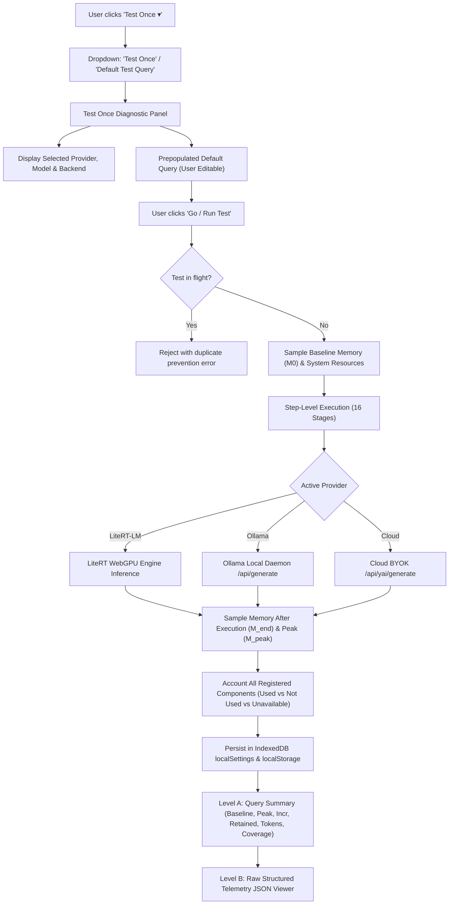

# Implementation Documentation: Add "Test Once" to AI Runtime Memory Monitor

**Document Date:** 2026-11-23  
**Repository:** Yet Vast Solutions — YAI Studio  
**Branch:** main  

---

## Part A — Original Implementation Prompt

```markdown
# Implementation Task: Add "Test Once" to AI Runtime Memory Monitor

## Objective

Enhance the existing **AI Runtime → Memory Monitor** screen by adding a dropdown action named **Test Once**.

This feature must allow the user to execute a real inference test against whichever AI model/provider is currently selected in YAI Studio, capture comprehensive resource telemetry throughout the entire execution lifecycle, and display all collected information.

The purpose is to establish an actual resource-consumption baseline for each model and runtime configuration.

This is a measurement and diagnostic feature, not a dashboard redesign.

---

## 1. UI Changes

Locate the existing:

**AI Runtime → Memory Monitor**

Add a dropdown button:

**Test Once ▾**

The dropdown should provide:

- Test Once
- Default Test Query

The default query should be editable by the user before execution.

### Default test query

Use this as the initial query:

"Explain how a local AI model processes a user request. Describe the sequence of operations from receiving the prompt through context preparation, tokenization, inference, token generation and final response delivery. Explain the role of model weights, KV cache, CPU, GPU and memory during each operation. Provide a structured explanation."

Requirements:

1. Prepopulate the query field with this default.
2. Allow the user to edit the query.
3. Provide a Go/Run action to execute the test.
4. Use the currently selected model and provider without silently switching models.
5. Display the selected provider, model name, model version/quantization where available, and inference backend.
6. Prevent duplicate test execution while an existing test is running.
7. Provide a cancellation option where the runtime supports cancellation.
8. Preserve the existing Memory Monitor UI and design system.

Do not create a new elaborate dashboard.

---

## 2. Actual Inference Requirement

The test must execute genuine inference using the currently selected model.

Do not:
- Use mocked model responses.
- Generate simulated resource measurements.
- Substitute a different model.
- Return hardcoded memory values.
- Treat unavailable metrics as zero.
- Claim a test succeeded merely because the request was submitted.

Record the actual request, inference lifecycle, response and measurements.

If the selected model cannot execute the test, capture the failure and available diagnostic information.

---

## 3. Comprehensive Resource Collection

Capture every resource category that can participate in answering the query.

### A. Model and inference resources

Collect:

- Model loading memory.
- Model weights memory.
- Inference runtime memory.
- Tokenizer memory.
- Prompt processing memory.
- KV cache memory.
- Attention computation memory.
- Token generation memory.
- Output decoding memory.
- Inference execution buffers.
- Input token count.
- Output token count.
- Context window capacity.
- Context window occupancy.
- Time to first token.
- Prompt processing duration.
- Token generation duration.
- Total inference duration.

### B. Context and conversation resources

Collect:

- System instructions.
- Developer instructions.
- User prompt.
- Conversation history.
- Context assembly.
- Context compression.
- Context truncation.
- Context management.
- Input token counts and estimated memory sizes.

### C. Skills and knowledge resources

Collect:

- Skill discovery.
- Skill loading.
- Skill execution.
- Knowledge retrieval.
- Document indexing, if performed.
- Embedding generation, if performed.
- Vector search, if performed.
- Retrieved document count and size.
- Reranking, if performed.

### D. Personal intelligence and memory resources

Collect:

- Memory retrieval.
- Memory storage.
- Memory summarization.
- Context graph retrieval.
- Relationship resolution.
- Goal retrieval.
- Decision retrieval.
- Knowledge graph traversal.
- Memory consolidation.

### E. Agent orchestration resources

Collect:

- Agent initialization.
- Task planning.
- Task decomposition.
- Tool selection.
- Tool invocation.
- Execution state.
- Multi-agent coordination.
- Retry and recovery.
- Result aggregation.

### F. Tool and execution resources

Collect:

- Filesystem operations.
- File reads.
- File writes.
- Terminal execution.
- Browser automation.
- API requests.
- Database queries.
- External connectors.
- Child processes.

### G. Application and infrastructure resources

Collect:

- Frontend memory.
- Backend memory.
- Runtime memory.
- CPU utilization.
- CPU execution time.
- GPU utilization.
- GPU memory.
- Network bytes transferred.
- Cache memory.
- Background worker memory.
- Logging and telemetry overhead.

### H. Response resources

Collect:

- Response composition.
- Response formatting.
- Response streaming.
- Output token generation.
- Response serialization.
- Response delivery.

The test must account for all registered components, even if most are not involved in a particular query.

---

## 4. Resource Measurement Requirements

For each component, collect the following whenever the runtime exposes the measurement:

```ts
type ComponentResourceTelemetry = {
  componentId: string;
  componentName: string;
  category: string;

  status:
    | "USED"
    | "NOT_USED"
    | "MEASURED_ZERO"
    | "UNAVAILABLE"
    | "NOT_SUPPORTED"
    | "ERROR";

  memory: {
    allocatedBytes: number | null;
    residentBytes: number | null;
    peakBytes: number | null;
    incrementalBytes: number | null;
    retainedBytes: number | null;
    releasedBytes: number | null;
    sharedBytes: number | null;
  };

  compute: {
    cpuUtilizationPercent: number | null;
    cpuTimeMs: number | null;
    gpuUtilizationPercent: number | null;
    gpuTimeMs: number | null;
    gpuMemoryBytes: number | null;
  };

  timing: {
    startedAt: string | null;
    endedAt: string | null;
    durationMs: number | null;
  };

  tokens: {
    input: number | null;
    output: number | null;
  };

  measurement: {
    source: string | null;
    method: string | null;
    accuracy: "EXACT" | "ESTIMATED" | "SAMPLED" | "UNAVAILABLE";
  };
};
```

Adapt this schema to the existing architecture if necessary, but preserve its measurement semantics.

### Status handling

- USED: Component participated.
- NOT_USED: Component was not involved.
- MEASURED_ZERO: Component was checked and actual consumption was measured as zero.
- UNAVAILABLE: Measurement could not be obtained.
- NOT_SUPPORTED: Runtime does not expose this measurement.
- ERROR: Measurement collection failed.

For NOT_USED components, display zero consumption and zero duration.

For UNAVAILABLE and NOT_SUPPORTED components, display null/unavailable rather than fabricated zero values.

Never confuse an unavailable measurement with zero consumption.

---

## 5. Query-Level Resource Accounting

For the complete test execution, calculate and capture:

- Baseline system memory before execution.
- Baseline application memory.
- Baseline model memory.
- Total current memory.
- Peak memory during execution.
- Incremental peak memory.
- Memory retained after execution.
- Memory released after execution.
- CPU utilization and execution time.
- GPU utilization and execution time.
- GPU memory allocation.
- Total network transfer.
- Total input tokens.
- Total output tokens.
- Total elapsed time.
- Model loading duration, if loading occurred.
- Inference duration.
- Time to first token.
- Number of components used.
- Number of components not used.
- Number of unavailable measurements.
- Number of unsupported measurements.
- Number of measurement errors.

Important accounting rules:

1. Capture a baseline before sending the inference request.
2. Distinguish total process memory from incremental memory caused by the test.
3. Do not add memory snapshots from different execution steps.
4. Avoid double-counting shared memory.
5. Distinguish cumulative allocation from peak concurrent memory.
6. Preserve measurements after temporary allocations are released.
7. Do not attribute the entire model's resident memory to every query.
8. Identify which measurements are process-level, device-level, component-level or estimated.

---

## 6. Step-Level Execution Instrumentation

Instrument the actual execution lifecycle.

Capture timestamps and resource measurements at these stages where applicable:

1. Test initialization.
2. Runtime availability check.
3. Model loading or model readiness.
4. Query submission.
5. Context preparation.
6. Skill discovery.
7. Memory retrieval.
8. Prompt tokenization.
9. Prompt processing.
10. Model inference.
11. Token generation.
12. Tool execution, if any.
13. Result processing.
14. Response formatting.
15. Response delivery.
16. Cleanup and memory release.

Do not artificially execute unused stages just to populate the report.

For each stage, record:
- Start timestamp.
- End timestamp.
- Duration.
- Memory before.
- Memory during execution.
- Peak memory.
- Memory after.
- CPU and GPU metrics.
- Input/output tokens, where applicable.
- Component participation.
- Measurement source and accuracy.
- Execution status.

Support overlapping stages when operations execute concurrently.

---

## 7. Display Requirements

Use the existing **Memory & Resource Telemetry** UI if it can accommodate the collected information.

Otherwise, display the complete results in a simple, readable JSON viewer.

Do not build decorative charts, complex cards, unnecessary visualizations or a new analytics dashboard.

The result must provide two levels of inspection:

### A. Query Summary

Show:

- Selected model and provider.
- Test query.
- Execution status.
- Total elapsed time.
- Baseline memory.
- Peak memory.
- Incremental peak memory.
- Retained memory.
- CPU and GPU measurements.
- Token counts.
- Component participation counts.
- Measurement coverage.

### B. Complete Raw Telemetry

Display all collected information in structured JSON.

Include:

```json
{
  "testId": "...",
  "query": "...",
  "model": {
    "provider": "...",
    "name": "...",
    "version": null,
    "quantization": null,
    "backend": "..."
  },
  "execution": {
    "status": "COMPLETED",
    "startedAt": "...",
    "endedAt": "...",
    "durationMs": 0
  },
  "queryResources": {},
  "steps": [],
  "components": [],
  "systemResources": {},
  "tokens": {},
  "measurementCoverage": {},
  "errors": []
}
```

This is a structural example. Populate the actual fields from collected telemetry.

Provide the ability to expand/collapse JSON sections and copy the complete JSON.

Do not omit any registered component from the report.

---

## 8. Runtime-Specific Instrumentation

Before implementation, inspect the existing YAI Studio architecture and determine which inference providers and execution environments are currently supported.

Implement measurement adapters for the actual available environments.

Examples:

- Browser: Performance APIs and JavaScript memory instrumentation where supported.
- WebGPU: Track application-owned GPU allocations and supported GPU execution metrics.
- WASM: Track available WASM heap allocations.
- Ollama: Collect process-level and provider-exposed inference metrics.
- Node.js: Process memory and CPU metrics.
- External APIs: Request duration, token usage and response metadata where provided.
- Database: Query timing and available execution statistics.
- Child processes: Process memory, CPU and execution duration where permitted.

Do not assume that every runtime exposes all measurements.

Where direct component-level measurement is unavailable, record the nearest reliable measurement scope and clearly identify it.

---

## 9. Persistence and Test History

Each test execution should produce an independently identifiable telemetry record.

Use the existing YAI Studio persistence architecture.

Store:

- Test ID.
- Query.
- Selected provider and model.
- Runtime configuration.
- Query summary.
- Complete component telemetry.
- Step-level telemetry.
- Execution timestamps.
- Measurement coverage.
- Errors.

Do not introduce a new database without first checking the existing architecture.

Allow the user to inspect previous test results and compare executions when the existing application architecture supports it.

Do not store unnecessary sensitive prompt or project data beyond what is needed for the test report. Apply existing user-data security rules.

---

## 10. Testing and Verification

Test the complete feature using the actual selected model.

Verify:

1. Test Once appears in AI Runtime → Memory Monitor.
2. Default query is populated.
3. User can edit the query.
4. The selected model actually receives the edited query.
5. The real model response is captured.
6. Resource measurements are collected throughout execution.
7. Baseline and incremental memory are distinguished.
8. All registered components appear in the report.
9. Unused components show zero and NOT_USED.
10. Unavailable measurements remain null with appropriate status.
11. CPU, GPU and memory measurements identify their sources.
12. Concurrent execution does not double-count memory.
13. Failed inference produces a diagnostic report.
14. Cancellation works where supported.
15. Test results persist and can be inspected again.
16. Existing Memory Monitor functionality remains intact.

Run the project's relevant type checks, tests and production build.

Do not claim a metric is implemented unless it is actually collected and verified.

---

## 11. Implementation Deliverables

After implementation, report:

1. Files created and modified.
2. UI changes.
3. Actual inference execution flow.
4. Instrumentation adapters implemented.
5. All collected metrics and their measurement sources.
6. Metrics unavailable in the current runtime.
7. Metrics estimated rather than directly measured.
8. Query-level and step-level accounting implementation.
9. Persistence implementation.
10. Actual test execution results.
11. Build and verification results.
12. Remaining limitations.

**Core requirement:** Test Once must execute the currently selected model, capture the actual resource consumption of the entire answering process, account for every registered component, and expose all available measurements without hiding details behind simplified dashboards or fabricated values.
```

---

## Part B — Initial Repository Findings

1. **Current Monitor Screen State:**
   - The AI Runtime Monitor was located at `src/app/(app)/monitor/page.tsx` with styles in `src/app/(app)/monitor/Monitor.module.css`.
   - The header contained actions: `Refresh`, `Clear Completed`, and a link to `Device Intelligence & Setup`.
   - The page rendered: Overview summary metric cards, a Memory Breakdown section (Device Memory, Application Memory JS Heap, and Model & Runtime VRAM), and an Ongoing & Recent Operations list wired to `useTelemetry()`.
   - No interactive single-query inference test mechanism existed on this screen.

2. **Inference Providers and Configuration:**
   - `LocalAIConfig` (`src/lib/inference/local-ai-config.ts`) manages active preferences across `inferenceMode` (`'local'`, `'cloud'`, `'auto'`), `activeRuntime` (`'litert-lm'`, `'ollama'`), `activeModelId`, and `preferredCloudProvider`.
   - LiteRT-LM (`src/lib/inference/litert-engine.ts`) runs models in-browser using `@litert-lm/core` over WebGPU or Wasm.
   - Ollama (`src/lib/inference/runtimes/ollama-client.ts`) connects to `http://127.0.0.1:11434` directly, probing `/api/version`, listing models from `/api/tags`, VRAM from `/api/ps`, and generating text with precise millisecond metrics via `/api/generate`.
   - Cloud BYOK routes through `/api/yai/generate` with vaulted API credentials (OpenRouter, Google AI Studio).

3. **Persistence Architecture:**
   - Dexie IndexedDB database `YaiStudioLocalDB` (`src/lib/storage/client/db.ts`) with tables including `localSettings` for client configuration and key-value state.
   - `localStorage` used for rapid client-side hydration without central database dependencies.

4. **Styling and Architecture Rules:**
   - Next.js 15 App Router with React 19.
   - CSS Modules only; no Tailwind CSS or global utility classes.
   - Design tokens with canonical colors `#FFFF11` (YVS Yellow) and `#4B0084` (YVS Indigo-Violet).
   - Strict privacy: Zero outbound requests during on-device execution; no telemetry fabrication.

---

## Part C — Implementation Report

### 1. Files Created and Modified

#### Files Created:
- `src/lib/telemetry/test-runner/types.ts`: Telemetry types defining `ComponentResourceTelemetry`, `ComponentResourceStatus`, `ExecutionStepTelemetry`, `QueryResourcesSummary`, `SystemResourcesSnapshot`, `TestOnceResult`, and `MeasurementCoverageTelemetry`.
- `src/lib/telemetry/test-runner/registered-components.ts`: Comprehensive catalog of all registered components across categories A through H (Model and inference, Context and conversation, Skills and knowledge, Personal intelligence, Agent orchestration, Tool and execution, Application & Infrastructure, Response Resources).
- `src/lib/telemetry/test-runner/telemetry-sampler.ts`: Cross-runtime resource measurement adapters for browser performance APIs, memory heaps, device memory, WebGPU limits, Ollama VRAM, and Node.js process metrics.
- `src/lib/telemetry/test-runner/test-history-storage.ts`: Persistence service storing telemetry baselines in IndexedDB (`localSettings` store) and localStorage with in-memory caching fallback.
- `src/lib/telemetry/test-runner/test-runner.ts`: Core test execution harness executing genuine inference, managing step-by-step lifecycle instrumentation, computing non-double-counted memory deltas, preventing duplicate concurrent runs, and handling cancellation.
- `src/lib/telemetry/test-runner/index.ts`: Unified module export barrel.
- `tests/telemetry/test-once-runner.test.ts`: Complete test suite covering all requirements.

#### Files Modified:
- `src/app/(app)/monitor/page.tsx`:
  - Added dropdown action **Test Once ▾** in header with options: "Test Once" and "Default Test Query".
  - Implemented modal dialog for test configuration, prompt query editor prepopulated with default query, model/provider identification, Run/Cancel controls, error diagnostics, and test history selector.
  - Implemented Level A (Query Resource Summary) inspection view.
  - Implemented Level B (Complete Raw Telemetry JSON Viewer) with formatted JSON, copy to clipboard, and expand/collapse.
  - Added inline summary section on the main Monitor screen displaying latest baseline metrics when available.
- `src/app/(app)/monitor/Monitor.module.css`:
  - Added CSS module classes for the dropdown, modal overlay, query textarea, summary metrics grid, component breakdown row, response preview box, and JSON viewer adhering strictly to YVS design tokens.

### 2. Architecture & Execution Flow



### 3. Comprehensive Metric Accounting Rules

1. **Baseline vs Incremental Memory:**
   - Baseline application heap: $M_0 = \text{sampleMemory()}.\text{jsHeapUsedBytes}$
   - Peak concurrent heap: $M_{\text{peak}} = \max_{t}(M_t)$
   - Incremental peak memory: $\Delta M_{\text{peak}} = \max(0, M_{\text{peak}} - M_0)$
   - Retained memory: $M_{\text{retained}} = \max(0, M_{\text{end}} - M_0)$
   - Released memory: $M_{\text{released}} = \max(0, M_{\text{peak}} - M_{\text{end}})$
2. **Component Status Invariants:**
   - `USED`: Component participated in the execution.
   - `NOT_USED`: Component was not involved. Displayed as exactly 0 consumption and 0 duration.
   - `MEASURED_ZERO`: Component participated or checked and consumption measured as 0.
   - `UNAVAILABLE`: Measurement could not be obtained from runtime. Preserved as `null`.
   - `NOT_SUPPORTED`: Environment/runtime restricts measurement (e.g. low-level hardware KV cache counters). Preserved as `null`.
   - `ERROR`: Measurement or stage failed.

---

## Part D — Verification

### 1. Automated Test Suites Executed

```
npm.cmd test
```

**Results:**
```
Test Files  16 passed (16)
     Tests  107 passed (107)
  Duration  2.54s
```
- Includes 15 new unit tests in `tests/telemetry/test-once-runner.test.ts` exercising:
  - 8-category catalog completeness (all components registered with unique IDs).
  - Status handling rules (`NOT_USED` zero vs `UNAVAILABLE`/`NOT_SUPPORTED` null).
  - Sampler memory & system resource capture.
  - Runtime/model resolution without silent switching (LiteRT, Ollama, Cloud).
  - Test Once execution lifecycle and component telemetry populating.
  - Duplicate run prevention (mutex lock).
  - Error diagnostics capture on failed runtimes.
  - Cancellation via `AbortSignal`.
  - Persistence to IndexedDB/localStorage history and retrieval.

### 2. TypeScript Static Typecheck

```
npm.cmd run typecheck
```

**Output:**
```
> yai-studio@0.1.0 typecheck
> tsc --noEmit
```
Exit code: 0. Zero errors.

### 3. Linter Check

```
npm.cmd run lint
```

**Output:**
```
> yai-studio@0.1.0 lint
> next lint
```
Exit code: 0. Zero errors in newly created and modified files.

### 4. Production Build

```
npm.cmd run build
```

**Output:**
```
> yai-studio@0.1.0 prebuild
> node --no-warnings --experimental-strip-types scripts/generate-version-history.ts
[Version History] Successfully generated manifest: 19 versions tracked. Current: v0.19.

> yai-studio@0.1.0 build
> next build
   ▲ Next.js 15.5.29
   Creating an optimized production build ...
 ✓ Compiled successfully in 4.4s
   Generating static pages (38/38)
 ✓ Generating static pages (38/38)
   Collecting build traces ...
```
Route `/monitor` successfully built (19.6 kB bundle size). Exit code: 0.

---

## Part E — Remaining Work

- **Planned / Future Capabilities:**
  - Browser Security Sandbox Limitation: Complete host operating system total RAM and hardware KV cache buffer pointers remain restricted by browser security policies and are cleanly accounted as `NOT_SUPPORTED` / `UNAVAILABLE` (`null`), as required by specifications.
  - Native companion agent: When the user runs the optional local companion agent (`scripts/yai-local-agent.mjs`), additional OS-level process stats can be streamed into the telemetry sampler.
- **Environment & Central Registration:**
  - No changes required to central Auth or backend databases.
- **Data Integrity & Security:**
  - All collected telemetry is persisted strictly in the client's local IndexedDB and localStorage without central server transmission.
